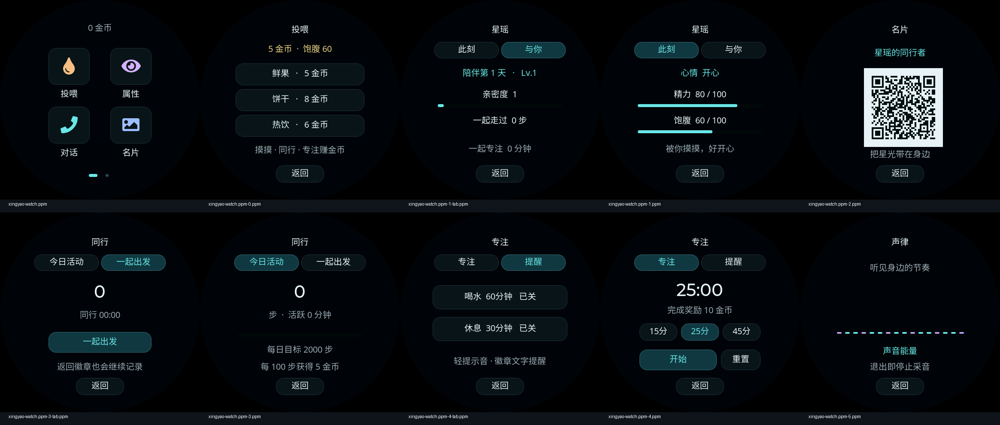

# 星瑶 · Xingyao Badge

以陪伴、动作和互动为核心的中文电子徽章，适配 **Waveshare ESP32-S3-Touch-AMOLED-1.75C**：466×466 圆形 AMOLED、32MB Flash、8MB PSRAM。徽章常驻展示，手表风格拓展桌面提供轻量应用，语音对话按需开启。



*上图由实际 LVGL 页面在主机渲染，用于展示界面；不代表设备帧率。*

## 已实现

- **动态徽章**：原创粉紫形象、呼吸与摆动、自然眨眼、触摸开心与连续触摸害羞；六轴带动头部回正、左右倾倒和惯性跟随，摇晃不触发表情。
- **投喂与养成**：活跃度获取金币，购买鲜果、饼干和热饮；保存饱腹、精力、心情、亲密度、成长等级及共同活动记录。
- **两页拓展桌面**：投喂、属性、对话、名片 / 同行、专注、声律、设置；无桌面标题，适配圆屏边缘。
- **同行**：佩戴活动估计、今日步数、出发计时；没有 GPS 轨迹或蓝牙寻人。
- **专注与提醒**：15 / 25 / 45 分钟专注，暂停与继续；喝水、休息提醒。
- **声律**：读取麦克风声音能量，退出页面停止采音；不做 FFT，不联网上传。
- **按需对话**：复用上游配网、激活、协议及音频实现；普通冷启动不初始化网络和音频。

## 按键与手势

| 操作 | 行为 |
| --- | --- |
| BOOT 短按 | 徽章与拓展桌面切换；黑屏时先唤醒 |
| PWR 短按 | 400ms 渐暗息屏 / 渐亮唤醒，途中可反向切换 |
| PWR 长按约 4 秒 | 硬件关机 |
| 徽章上滑或长按 | 打开拓展桌面 |
| 桌面左右滑动 | 切换两页应用 |
| 桌面下滑 | 收起桌面 |
| 应用右滑或点击返回 | 返回上一级 |

息屏停止绘制、触摸、六轴跟随与计步，并结束对话或声律采音；专注、提醒和陪伴计时继续。首次使用后，共用音频资源保留，减少反复初始化。

## 烧录已验证的固件

仅适用于 **1.75C（带 C）**。下载仓库后进入 `firmware-badge`，该目录包含匹配的应用、资源、分区表及校验值，不含设备配网或个人数据备份。

```sh
python -m pip install 'esptool>=4.8,<5'
cd firmware-badge
# macOS / Linux 用实际串口替换占位符；Windows 使用 COM 端口。
python -m esptool --chip esp32s3 --port <串口> --baud 460800 write_flash @flash_args
```

首次烧录前应备份原设备。首次安装或图片资源变化时，按完整清单烧录；资源校验值相同的纯代码更新才可单独更新应用。详细说明见 [烧录说明](firmware-badge/烧录说明.md)。本仓库不提供个别设备的整片 Flash 备份。

## 从源码构建

本徽章变体已在 **ESP-IDF 5.5.5** 验证。请先安装对应 SDK 并激活环境，依赖由 ESP-IDF Component Manager 按 `dependencies.lock` 下载。仓库包含预生成姿态库，普通构建无需重新制作图片。

```sh
source /path/to/esp-idf/export.sh
idf.py --version
./scripts/build_badge.sh
```

默认输出目录为 `~/.cache/anime-badge-build`；可通过 `BADGE_BUILD_DIR` 指定英文路径，避免中文构建路径引起 GCC specs 解析问题。编译结果不会自动覆盖仓库中已验证的 `firmware-badge` 文件。

GitHub Actions 自动运行主机测试；在 Actions 中手动运行 **Xingyao Badge** 工作流会额外构建这一款 ESP32-S3 徽章，不运行上游所有开发板的构建矩阵。

```sh
python3 -m unittest discover -s scripts/tests -v
```

主机页面验证见 [LVGL 预览说明](validation/desktop-render/README.md)。

## 金币与持久化

| 来源 | 奖励 / 限制 |
| --- | --- |
| 摸摸 | +5，冷却 5 分钟，每日最多 60 |
| 活动 | 每 100 步 +5，每日最多 100 |
| 开机陪伴 | 每 10 分钟 +2，每日最多 30 |
| 完成专注 | 15 / 25 / 45 分钟分别 +6 / +10 / +18 |
| 投喂 | 鲜果 5、饼干 8、热饮 6 金币；吃饱不扣币 |

金币和属性保存于独立 NVS。交易立即排队保存，普通累计数据每分钟保存，突然断电可能丢失最后一分钟累计记录。离线每日额度按累计开机 24 小时重置，有联网时间后按 UTC+8 日期计日；陪伴天数按累计开机时长计算。重启结束未完成的专注与出发计时。

## 性能与边界

2026-10-11 实机记录：徽章待机、语音未启动时，内部 RAM 剩约 **177 KiB**，PSRAM 剩约 **6.80 MiB**；启动音频及网络后会增加占用。当前资源包约 **8.21 MiB / 9 MiB**，其中动作姿态库约 **6.90 MiB**。另有 5 MiB 原厂 storage 分区，当前程序未接入。

动画采用分层 2D 图像、预计算倾角、局部表情和阻尼插值，并非完整 Live2D。此前实机动画绘制约 **10 帧/秒**，33ms 刷新调度不等于 30 FPS。动作平滑程度仍受有限姿态档位、解压和屏幕传输限制。

计步是基于佩戴运动的估计，需要按佩戴方式校准；名片为本地文字二维码，没有关联社交账号。续航、复杂网络环境下的对话和长时间佩戴仍需进一步测试。

最近验证记录：[应用验证](validation/companion-validation.json)、[按键与内存](validation/power-key-validation.json)。

## 素材与项目结构

- `main/boards/waveshare/esp32-s3-touch-amoled-1.75/`：徽章界面、养成状态、六轴和按键实现。
- `badge-assets/`：原创形象、分层素材、生成记录与预计算姿态库；素材沿用早期文件名，显示名称统一为星瑶。
- `scripts/build_badge_*.py`：复用 Pillow、LVGL / LZ4 的素材转换工具。
- `firmware-badge/`：经过烧录验证的可分段固件与 SHA256 清单。
- `partitions/badge32.csv`：沿用本板原厂 32MB 分区边界。

素材替换、构建策略与维护说明见 [徽章说明](README_徽章.md)。

## 来源与许可

基于 [78/xiaozhi-esp32 v2.4.0](https://github.com/78/xiaozhi-esp32/tree/v2.4.0)，上游提交 `5540258abcbfa62518d09959308200be1c5b1b2b`，保留 [MIT 许可证](LICENSE) 与原版权声明。本项目是独立的徽章改造，不是微雪官方徽章固件。上游说明保存在 [README_upstream.md](README_upstream.md)。

硬件适配参考 [微雪官方示例](https://github.com/waveshareteam/ESP32-S3-Touch-AMOLED-1.75C)，界面复用 [LVGL](https://github.com/lvgl/lvgl)、二维码复用其 Nayuki 实现，六轴与电源事件参考 [SensorLib](https://github.com/lewisxhe/SensorLib) 和 [XPowersLib](https://github.com/lewisxhe/XPowersLib)。第三方依赖遵循各自许可证。角色素材由 imagegen 生成，来源和提示词见 [素材说明](badge-assets/素材说明.md)。
